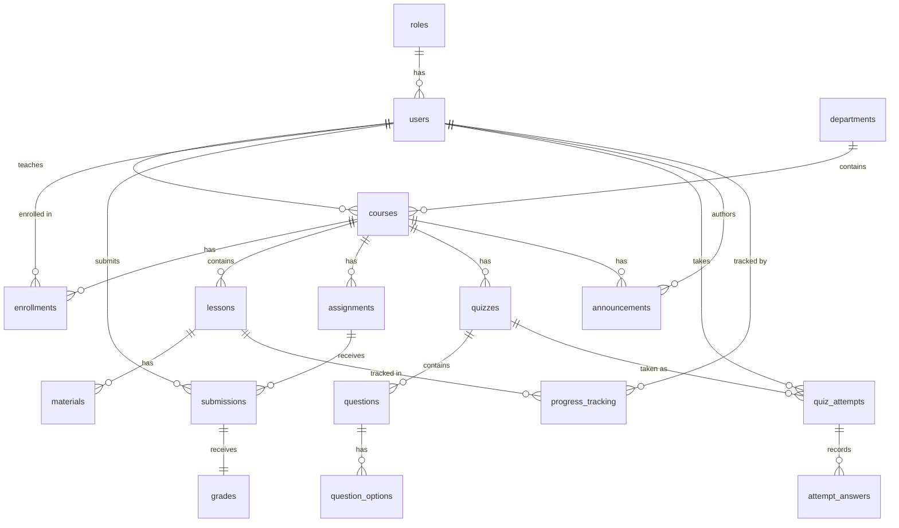

# Spree LMS — SQL Files

This directory contains the two SQL files required to bootstrap the Spree LMS database on **Supabase (PostgreSQL)**.

---

## Files

| File | Purpose |
|---|---|
| `supabase_schema.sql` | DDL — creates all tables, constraints, and indexes |
| `supabase_seed.sql` | DML — inserts demo roles, users, courses, quizzes, and more |

---

## Execution Order

> [!IMPORTANT]
> Always run **schema first**, then **seed**. Running seed before schema will fail because the tables do not exist yet.

```
1. supabase_schema.sql
2. supabase_seed.sql
```

---

## How to Run in the Supabase SQL Editor

1. Open your Supabase project → **SQL Editor** (left sidebar).
2. Click **New query**.
3. Paste the full contents of `supabase_schema.sql` and click **Run**.  
   Confirm all statements execute without errors.
4. Click **New query** again (or clear the editor).
5. Paste the full contents of `supabase_seed.sql` and click **Run**.

Both files are **idempotent**:
- Schema uses `CREATE TABLE IF NOT EXISTS` — safe to re-run.
- Seed uses `INSERT INTO … ON CONFLICT DO NOTHING` — duplicate rows are silently skipped.

---

## Demo Credentials

All demo accounts share the same password: **`Spree@123`**

| Role | Email |
|---|---|
| Admin | `admin@spree.edu` |
| Teacher | `teacher1@spree.edu` |
| Teacher | `teacher2@spree.edu` |
| Student | `student1@spree.edu` |
| Student | `student2@spree.edu` |
| Student | `student3@spree.edu` |
| Student | `student4@spree.edu` |
| Student | `student5@spree.edu` |

> [!NOTE]
> The `password_hash` column stores a bcrypt hash (cost factor 12) of `Spree@123`.  
> Hash value: `$2a$12$LQv3c1yqBWVHxkd0LHAkCOYz6TtxMQJqhN8/LewdBPj0NKdSpreeX`  
> This hash is for **development/demo use only**. In production, generate fresh hashes server-side.

---

## Seed Data Summary

| Entity | Count / Details |
|---|---|
| Roles | 3 — ADMIN, TEACHER, STUDENT |
| Users | 8 — 1 admin, 2 teachers, 5 students |
| Departments | 3 — Computer Science, Mathematics, Business |
| Courses | 4 — Python, DSA, Calculus I, Marketing (1 unpublished) |
| Enrollments | 9 across all published courses |
| Lessons | 5 — 3 for Python, 2 for Calculus I |
| Materials | 2 — attached to Python Lesson 1 |
| Assignments | 2 — one per CS course |
| Submissions | 1 — student1 submits FizzBuzz |
| Grades | 1 — teacher1 grades student1's submission (95/100) |
| Quizzes | 1 — Python Basics Quiz (20 min, 2 attempts) |
| Questions | 3 — MCQ, TRUE_FALSE, SHORT_ANSWER |
| Quiz Attempts | 1 — student2 completes the quiz (score: 4.00) |
| Attempt Answers | 3 — one per question |
| Announcements | 2 — 1 global, 1 course-scoped |
| Progress Tracking | 3 entries (students 1 & 2 on Python lessons) |

---

## Flyway / Schema Migration Note

> [!NOTE]
> `supabase_schema.sql` is intended as the **initial baseline** for the Spree database.  
> Going forward, **Flyway** (configured in `src/main/resources/db/migration/`) manages incremental schema changes via versioned migration scripts (`V2__...sql`, `V3__...sql`, etc.).  
>
> **Do not alter `supabase_schema.sql` directly after the initial deployment.**  
> Instead, create a new Flyway migration file for every schema change to keep application code and database schema in sync across all environments.

---

## Schema Overview


